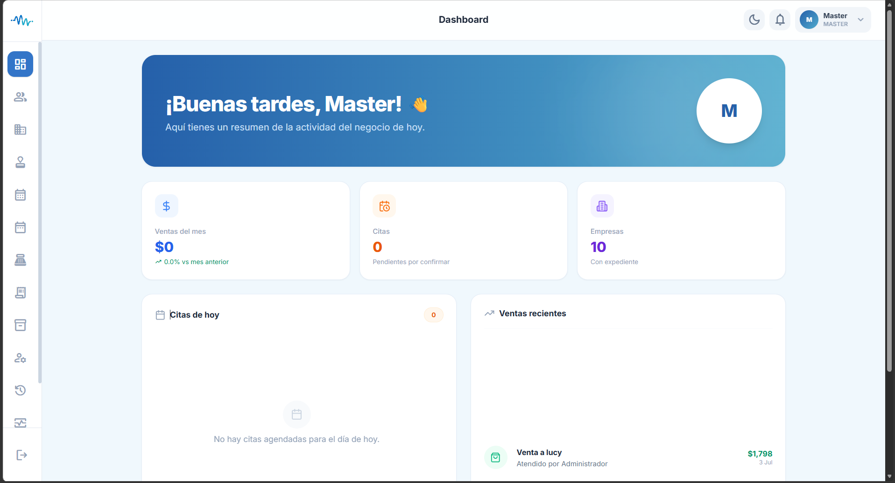
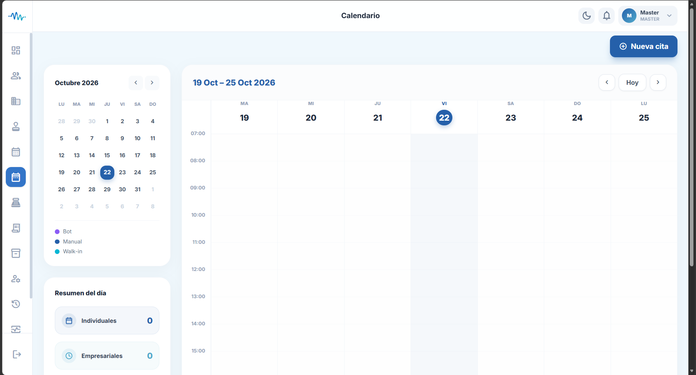
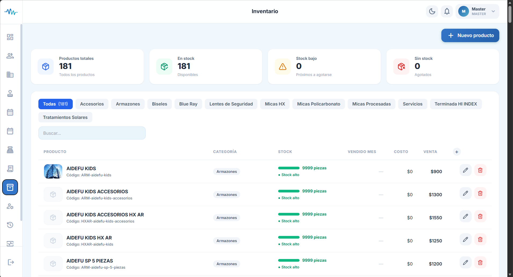

# Mediwork

### Sistema integral de gestión médica | Desarrollo Full-Stack

Mediwork es una plataforma web para la gestión y digitalización de procesos médicos y administrativos. Centraliza operaciones clínicas, administrativas y comerciales en un solo sistema, orientado a organizaciones del sector salud.

> **Estado del proyecto:** Código fuente disponible para consulta. La ejecución completa requiere configurar credenciales, variables de entorno y servicios externos que no forman parte de este repositorio.

---

## Funcionalidades principales

- **Autenticación y usuarios:** inicio de sesión, gestión de cuentas y control de acceso por roles.
- **Gestión de pacientes:** consulta y administración de información clínica.
- **Agenda médica:** gestión y seguimiento de citas con calendario interactivo.
- **Expedientes médicos:** organización y documentación clínica por paciente.
- **Recetas y exámenes:** gestión de información médica y resultados.
- **Encuestas y formularios:** creación, configuración y captura de respuestas.
- **Empresas y portales:** administración de empresas y acceso diferenciado para sus usuarios.
- **Inventario y punto de venta:** administración de productos, movimientos y operaciones comerciales.
- **Reportes:** consulta y organización de información operativa.
- **Tiempo real:** notificaciones y actualizaciones en vivo mediante WebSockets.
- **Integraciones externas:** Google AI, WhatsApp, OneDrive, Google Drive, Nodemailer.

---

## Capturas de pantalla

### Dashboard principal
Vista general del sistema con indicadores clave, accesos directos y métricas operativas.



### Agenda médica
Gestión y programación de citas con calendario interactivo y visualización por especialista.



### Control de inventario
Administración y consulta del catálogo de armazones, productos y existencias.



### Punto de venta (POS) y cotizador
Módulo de ventas, cotizaciones guiadas y registro de transacciones comerciales.


---

## Stack tecnológico

| Área | Tecnologías |
|---|---|
| Frontend | React 18, TypeScript, Vite |
| Estilos | Tailwind CSS |
| Estado y datos | Zustand, TanStack React Query |
| Formularios | React Hook Form, Zod |
| Gráficas y calendario | Recharts, FullCalendar |
| Backend | Node.js, Express, TypeScript |
| Base de datos | PostgreSQL 16 |
| ORM | Prisma |
| Autenticación | JWT, bcrypt |
| Tiempo real | Socket.IO |
| Generación de PDF | jsPDF, pdf-lib |
| IA | Google Generative AI (Gemini) |
| Infraestructura | Docker, Docker Compose, Nginx |
| Almacenamiento | OneDrive / Google Drive (configurable) |

---

## Roles del sistema

| Rol | Función principal |
|---|---|
| **Master** | Acceso total al sistema y configuración avanzada. |
| **Admin** | Gestión de usuarios, configuración y reportes generales. |
| **Doctor** | Atención de pacientes, expedientes clínicos y agenda médica. |
| **Agent** | Gestión de citas y operaciones administrativas. |
| **Empresa** | Portal para consultar resultados de empleados corporativos. |
| **Paciente** | Acceso a su propio expediente y resultados clínicos. |
| **Paciente Tablet** | Acceso en modo quiosco para captura guiada de encuestas. |

---

## Arquitectura general

```text
┌────────────────────────────────────────┐
│              Usuario / Browser         │
└───────────────────┬────────────────────┘
                    │
                    ▼
┌────────────────────────────────────────┐
│              Nginx (proxy)             │
│           http://localhost:3000        │
└──────────┬─────────────────┬───────────┘
           │                 │
           ▼                 ▼
┌──────────────────┐  ┌──────────────────┐
│  Frontend        │  │  Backend API     │
│  React + Vite    │  │  Node.js/Express │
│  :5173           │  │  :4000           │
└──────────────────┘  └────────┬─────────┘
                               │ Prisma ORM
                               ▼
                    ┌──────────────────┐
                    │   PostgreSQL 16  │
                    │   :5432          │
                    └──────────────────┘
```

---

## Estructura del repositorio

```text
mediwork/
├── frontend/
│   ├── src/
│   │   ├── components/     # Componentes reutilizables
│   │   ├── pages/          # Vistas por módulo
│   │   ├── services/       # Llamadas a la API
│   │   └── stores/         # Estado global (Zustand)
│   └── package.json
├── backend/
│   ├── src/
│   │   ├── middleware/     # Autenticación y validaciones
│   │   ├── routes/         # Endpoints de la API
│   │   ├── services/       # Lógica de negocio
│   │   └── scripts/        # Utilidades y migraciones
│   ├── prisma/             # Esquema y configuración de la BD
│   └── package.json
├── docker-compose.yml       # Servicios para desarrollo
├── docker-compose.prod.yml  # Configuración para producción
├── Dockerfile.nginx
├── nginx.conf
└── .env.example
```

---

## Instalación y ejecución

### Requisitos previos

- [Docker Desktop](https://www.docker.com/products/docker-desktop/)

### Ejecución con Docker

```bash
git clone https://github.com/proyectosliz16-coder/MediWork.git
cd MediWork
cp .env.example .env
# Edita .env con tus credenciales y servicios externos
docker compose up --build
```

| Servicio | Dirección |
|---|---|
| Aplicación (vía Nginx) | http://localhost:3000 |
| Frontend directo | http://localhost:5173 |
| Backend API | http://localhost:4000 |
| PostgreSQL | localhost:5432 |

Para detener:

```bash
docker compose down
```

---

## Variables de entorno

El proyecto requiere un archivo `.env` basado en `.env.example`.

```env
JWT_SECRET=change-me-in-prod-please

# Almacenamiento en la nube (OneDrive o Google Drive, opcional)
CLOUD_STORAGE_PROVIDER=onedrive
ONEDRIVE_TENANT_ID=
ONEDRIVE_CLIENT_ID=
ONEDRIVE_CLIENT_SECRET=

# WhatsApp Business API
WHATSAPP_PHONE_NUMBER_ID=
WHATSAPP_ACCESS_TOKEN=

# Google AI (Gemini)
GOOGLE_API_KEY=
```

> **Importante:** no incluyas credenciales reales en el repositorio. El archivo `.env` nunca debe subirse al control de versiones.

---

## Contexto del proyecto

Proyecto desarrollado durante una experiencia profesional en **Laia Technologies**.

---

**Mediwork** 
*Tecnología para la gestión integral de procesos médicos.*
